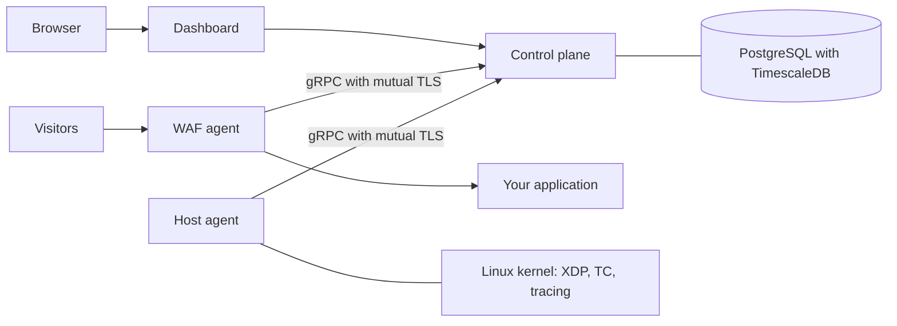

# WAFio

[](https://github.com/Wafio/wafio/releases/latest)
[](https://scorecard.dev/viewer/?uri=github.com/Wafio/wafio)
[](LICENSE)

WAFio is a self-hosted web application firewall with a host firewall and runtime security for Linux servers. You
run a control plane, and agents on the servers you protect report to it.

This repository is the starting point of the project: what WAFio is, how to install it, where each part of the
code lives, and where to report a problem. The code itself is in the component repositories listed below.

## What it does

- **Web application firewall.** A reverse proxy in front of your application. It checks each request with semantic
  detection engines (SQL injection, cross-site scripting, command injection, path traversal and more), applies rate
  limits, bot checks, geo rules, custom rules and script rules, and can put an application in maintenance mode.
- **Host firewall.** eBPF programs at XDP and TC filter packets in the kernel: block and allow lists, geo blocking,
  port rules, SYN flood and port scan protection, and an egress blocklist.
- **Runtime security.** Kernel tracing of process, file and network events on the server, with detection rules,
  incidents and kill policies.
- **One dashboard** for every agent, with roles, projects, an audit log and the events of all three parts.

## Install

On a Debian, Ubuntu or RHEL family server, as root:

```sh
curl -fsSL https://wafio.cloud/install.sh | sudo bash
```

The installer downloads signed bundles, checks their SHA-256 and Ed25519 signatures, and installs the control plane,
the dashboard and the agents. Run it again to upgrade. Requirements, the steps one by one and the options are on
<https://wafio.cloud/get-started>. The documentation is at <https://wafio.cloud/docs>.

## How the parts fit



The control plane stores the configuration and the events, and serves the dashboard. The WAF agent keeps the last
configuration it received, so it goes on protecting your applications while the control plane is down. The host
agent filters packets and watches processes on the server itself.

## Repositories

| Repository | What it is | Language | Licence |
|---|---|---|---|
| [wafio](https://github.com/Wafio/wafio) | This one: the project's front page, platform releases, issues about the whole product | Markdown | GPL-3.0-only |
| [wafio-cp-backend](https://github.com/Wafio/wafio-cp-backend) | Control plane: HTTP API, agent server, database migrations, and the `shared` module both agents use | Go | GPL-3.0-only |
| [wafio-cp-frontend](https://github.com/Wafio/wafio-cp-frontend) | Dashboard, a static app the control plane serves | SvelteKit, TypeScript | GPL-3.0-only |
| [wafio-agent-waf](https://github.com/Wafio/wafio-agent-waf) | WAF agent: proxy, limits, bot checks, custom and script rules, maintenance mode, the link to the control plane | Rust | GPL-3.0-only |
| [wafio-agent-host](https://github.com/Wafio/wafio-agent-host) | Host agent: eBPF firewall and runtime security tracing | Go, BPF C | GPL-3.0-only, BPF programs GPL-2.0 |
| [uddin-lang-rs](https://github.com/Wafio/uddin-lang-rs) | Interpreter of the uddin script language, which runs script rules inside the WAF agent | Rust | MIT |

Two parts are not published:

- **The semantic detection engine**, which decides whether a request is an attack. The WAF agent calls it through
  one interface (`crates/engine-api` in wafio-agent-waf). An agent built from wafio-agent-waf alone proxies and
  enforces every other rule, and its engine finds nothing. The official build includes the engine.
- **The installers and the release scripts.** The installer you run is served at <https://wafio.cloud/install.sh>.

## Releases

A WAFio version is released for all parts together. The [releases of this repository](https://github.com/Wafio/wafio/releases)
name each version and link to its notes. The full notes of a version are in `docs/releases/` of wafio-cp-backend,
for example [v2.1.0](https://github.com/Wafio/wafio-cp-backend/blob/v2.1.0/docs/releases/v2.1.0.md). Fixes go into
the latest release; see [SECURITY.md](SECURITY.md) for the versions that get security fixes.

## Where a report or a change goes

| It is about | Where |
|---|---|
| Installing, upgrading, a question about the whole product, or you do not know which part | an issue in this repository |
| The dashboard: a page, a form, a chart | [wafio-cp-frontend](https://github.com/Wafio/wafio-cp-frontend/issues) |
| The API, accounts and roles, stored events, agent enrollment | [wafio-cp-backend](https://github.com/Wafio/wafio-cp-backend/issues) |
| Proxying, routes, limits, bot checks, custom rules, maintenance pages | [wafio-agent-waf](https://github.com/Wafio/wafio-agent-waf/issues) |
| The firewall, blocked or allowed packets, process tracing | [wafio-agent-host](https://github.com/Wafio/wafio-agent-host/issues) |
| The script language or a builtin | [uddin-lang-rs](https://github.com/Wafio/uddin-lang-rs/issues) |
| A security problem, an attack that was not detected | a private report, never a public issue: [SECURITY.md](SECURITY.md) |

## Support

Community support is the issue tracker of this repository and of the component repositories. Installation,
maintenance and support with a response time are offered by the WAFio team: see
<https://wafio.cloud/services> and <https://wafio.cloud/support>. [SUPPORT.md](SUPPORT.md) says which channel to use.

## Working on the code

The repositories find each other as folders next to one another, so clone the ones you need into one directory:

```sh
mkdir wafio-src && cd wafio-src
git clone https://github.com/Wafio/wafio-cp-backend
git clone https://github.com/Wafio/wafio-cp-frontend
git clone https://github.com/Wafio/wafio-agent-waf
git clone https://github.com/Wafio/wafio-agent-host
git clone https://github.com/Wafio/uddin-lang-rs
```

- wafio-agent-waf builds with `../uddin-lang-rs`.
- wafio-agent-host fetches the published `shared` module of wafio-cp-backend. You need `../wafio-cp-backend` only to
  change `shared`.
- The dashboard's fixture check reads `../wafio-cp-backend/test/frontend-fixtures`.

Each repository has one gate, `scripts/ci-local.sh`, which runs on Linux, and a `CONTRIBUTING.md` with its rules.
[CONTRIBUTING.md](CONTRIBUTING.md) here says how the project works as a whole, and [GOVERNANCE.md](GOVERNANCE.md)
who decides what.

## Best practices

Every component repository holds the OpenSSF Best Practices badge at the passing level and is scored by OpenSSF
Scorecard every week.

| Repository | Best practices | Scorecard |
|---|---|---|
| wafio-cp-backend | [](https://www.bestpractices.dev/projects/16869) | [](https://scorecard.dev/viewer/?uri=github.com/Wafio/wafio-cp-backend) |
| wafio-cp-frontend | [](https://www.bestpractices.dev/projects/16871) | [](https://scorecard.dev/viewer/?uri=github.com/Wafio/wafio-cp-frontend) |
| wafio-agent-waf | [](https://www.bestpractices.dev/projects/16868) | [](https://scorecard.dev/viewer/?uri=github.com/Wafio/wafio-agent-waf) |
| wafio-agent-host | [](https://www.bestpractices.dev/projects/16870) | [](https://scorecard.dev/viewer/?uri=github.com/Wafio/wafio-agent-host) |
| uddin-lang-rs | [](https://www.bestpractices.dev/projects/16872) | [](https://scorecard.dev/viewer/?uri=github.com/Wafio/uddin-lang-rs) |

Each release bundle comes with an Ed25519 signature and an SBOM, and the installer refuses a bundle whose signature
does not verify.

## Sponsors

| Sponsor | |
|---|---|
| <a href="https://zetguard.com"></a> | Funds the development of WAFio. |

To sponsor WAFio, write to <hello@wafio.cloud>.

## Licence

This repository and the open components are under the GNU General Public License, version 3 only ([LICENSE](LICENSE)),
except uddin-lang-rs (MIT) and the BPF programs of the host agent (GPL-2.0). The official builds downloaded from
wafio.cloud also include the detection engine, which is not open source; <https://wafio.cloud/terms> covers them.

**Commercial licence.** WAFio holds the copyright in the open components and can license them under other terms. A
company that wants to change WAFio and ship the result without the obligations of the GPL can get a commercial
licence. The BPF programs of the host agent stay under GPL-2.0 in every case, because they are built on kernel
headers and interfaces under GPL-2.0.
Write to <hello@wafio.cloud>.

How WAFio handles the open source it uses, ships and contributes to, and where to ask a licensing question:
[OPEN_SOURCE_POLICY.md](OPEN_SOURCE_POLICY.md).
